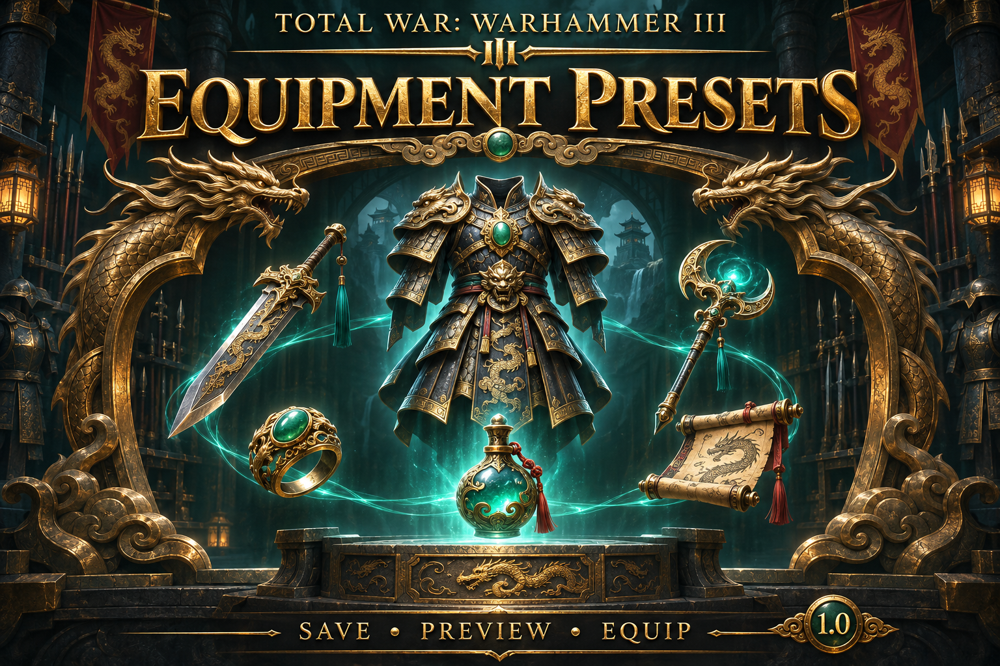
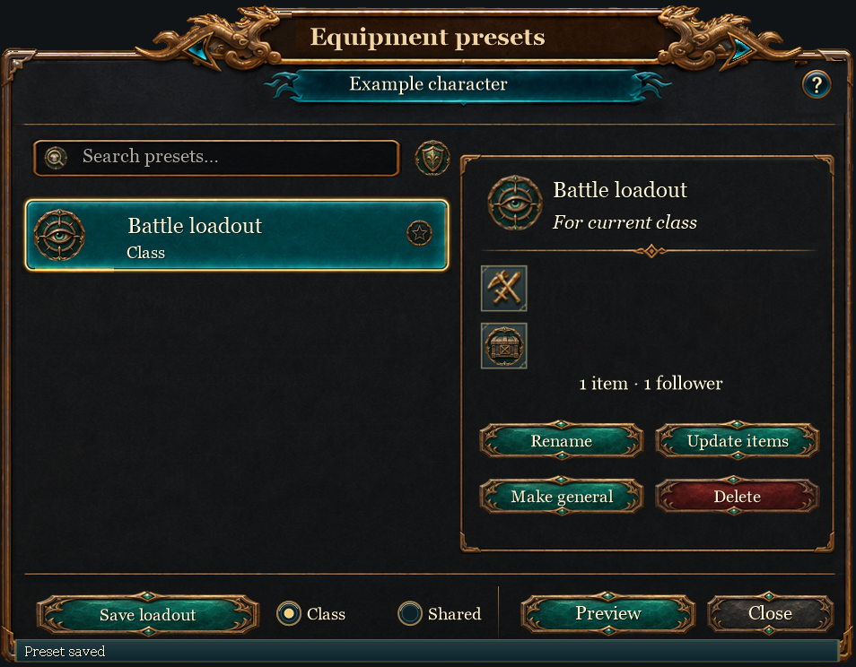
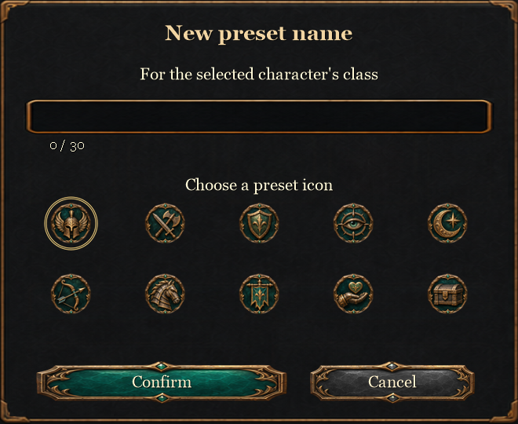
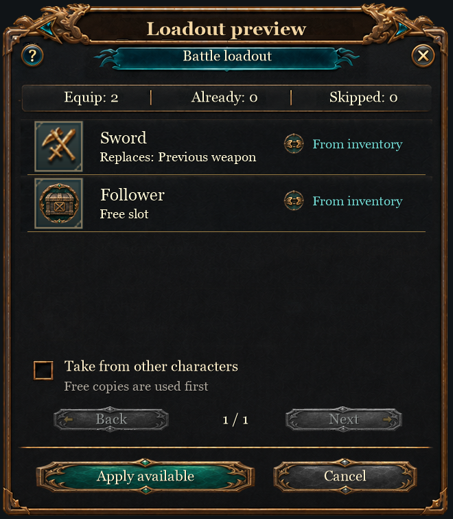
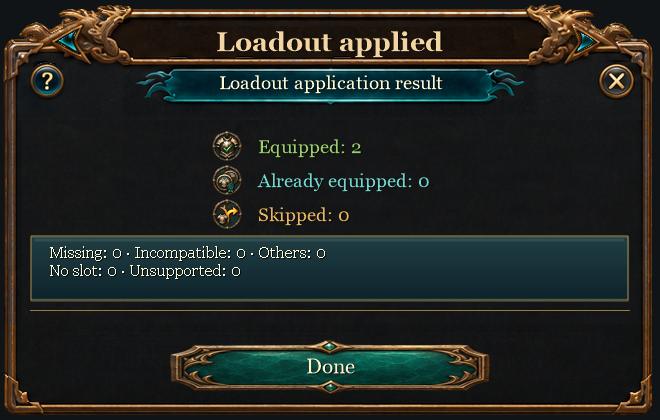

# WH3 Equipment Presets

**Equipment loadouts for Total War: WARHAMMER III · Release 1.0**

Save equipment and follower combinations, organize them in a persistent preset library, and preview changes before applying a loadout to a lord or hero.

  

## Features

- Save, rename, update and delete loadouts; choose from ten preset archetype icons.
- Keep class-specific loadouts or share a preset across the current faction.
- Search, filter and mark favorites with distinct hollow and filled star states.
- Preview equipment and followers, availability, replacements and skipped entries before applying.
- Use available copies first. Taking equipment from other characters is an optional setting.
- Review the application result and reasons for skipped entries.
- Retain your faction's preset library across game restarts and campaigns through the game's persistent registry.
- Character matching distinguishes lords, heroes and special character subtypes, including Cathayan caravan masters. Actual item and follower compatibility still follows the game rules.

Presets reference equipment you own; the mod does not create items. The separate development item-grant helper is not part of this release.

## Compatibility

**Developed and exercised on Total War: WARHAMMER III 8.1 (8.1.0.0).**

The mod is expected to work on game version **9 and later**, but those versions have **not been tested**. This is an expectation, not confirmed compatibility; UI or scripting changes may require an update.

The latest 1.0 artwork has passed offline asset and controller checks. A final in-game visual check of that artwork is still pending. Earlier builds were exercised in the game; this does not establish that every character, faction, language or resolution has been tested. Multiplayer compatibility has not been established.

## Languages

The interface follows the game's active text language. Unsupported languages and missing translations fall back to English. Character names, item names and game-provided descriptions remain supplied by the game.

| Language | Mod catalog | Game language ID |
|---|---|---|
| English | `eng` | `en` |
| Russian | `ru` | `ru` |
| Simplified Chinese | `cn` | `cn` |
| Traditional Chinese | `zh` | `zh` |
| Spanish | `sp` | `sp` |
| Portuguese (Brazil) | `br` | `br` |
| German | `ge` | `ge` |
| Japanese | `ja` | `ja` |
| French | `fr` | `fr` |
| Polish | `pl` | `pl` |
| Korean | `kr` | `kr` |

Translation catalogs are included; native rendering and translation quality have not been manually reviewed in every language.

## Install

1. Close the game.
2. Download `wh3_equipment_presets_probe.pack` from the [1.0 release](https://github.com/esnqduke/WH3-Equipment-Presets/releases/tag/v1.0).
3. Copy it into the game's `data` directory.
4. Enable it in the Total War launcher or your mod manager, then start the game.
5. Open a character's equipment screen and select **Presets**.

The historical `_probe` filename is retained for continuity; it is the release mod. Enable only one copy of this pack. No external mod manager or item-grant helper is required.

To update, close the game and replace the existing pack. To uninstall, close the game, disable the mod and remove its pack; removing the pack is not a command to erase the separately stored preset library.

## UI examples

Offline examples rendered from version 1.0 controller layouts, native TWUI templates and shipped textures. These are **not in-game screenshots**. Names and loadouts are demonstration data; follower portraits use a placeholder and font rendering is approximate. In-game visuals may differ.

### Preset library

### Create a preset and choose its icon

### Preview a loadout

### Application result

## Feedback

Please [report an issue](https://github.com/esnqduke/WH3-Equipment-Presets/issues) with the game version, language, resolution/UI scale, affected character type, reproduction steps, and a screenshot where relevant. Include other enabled mods when reporting conflicts.

## Development credits

Built through approximately **30 hours of development and iteration**.

- **Backend and mod logic:** GPT-6.1 Sol.
- **UI and visual design:** GPT-6 Astra.
- **Direction, requirements and in-game feedback:** esnqduke.

## Development

Runtime Lua and native TWUI resources are in `src/`; autonomous checks are in `tests/`. These checks simulate native boundaries and do not replace an in-game test. Release checksums accompany the downloadable pack.

This is an unofficial community mod for Total War: WARHAMMER III. Game names and game assets belong to their respective owners. No affiliation with or endorsement by Creative Assembly or SEGA is claimed.
