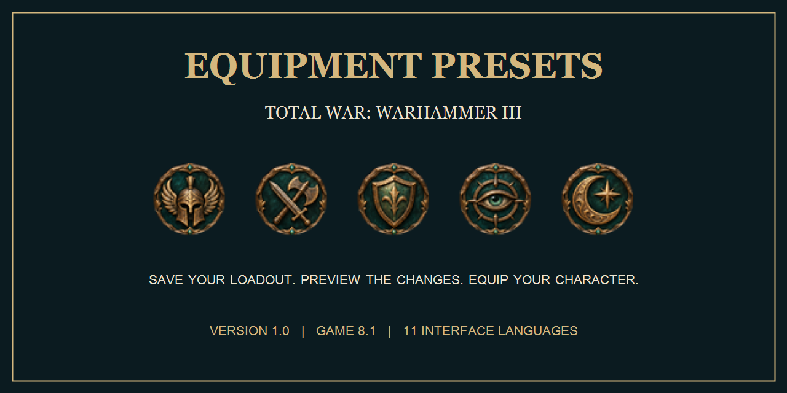

# Equipment Presets 1.0.1

## Changes

- Added `wh3ep/release.json` to record version1.0.1 and the author's compatibility report.
- All366 original pack entries remain byte-for-byte unchanged. No gameplay, preset storage or UI changes; PFH5 Mod format retained.
- The author uploaded this package to existing Steam Workshop item3835603760 and confirmed a new change-history entry. The local game-data pack was synchronized to the same file.

## Compatibility

The author reports that the existing build works on Total War: WARHAMMER III9.x; the exact tested patch and full coverage were not specified. The installed game executable was observed as9.0.5.0. This is not an independently verified exact-patch test. Later patches, all factions/characters/resolutions/languages and multiplayer are not comprehensively verified. Historical development/test baseline:8.1.

The metadata file is a release record, not a game compatibility header. No claim is made that the launcher outdated warning has been independently checked or cleared. Existing offline UI examples remain applicable because the UI is unchanged; they are not in-game screenshots. Earlier pending visual checks are not represented as newly completed.

## Download and install

Subscribe on [Steam Workshop](https://steamcommunity.com/sharedfiles/filedetails/?id=3835603760), or download the pack below, close the game, replace your existing pack in `data`, then enable it in your launcher. Enable only one copy; disable the manually installed copy if using Workshop. The separate test-items helper is not included.

Assets: `wh3_equipment_presets_probe.pack` and `SHA256SUMS.txt`.

SHA256: `DAE8D8C0EC43DEBE270AFF5F9A76043CCAC3CD3A8C011831360B49354E131B8C`.

## Languages

English, Russian, Simplified Chinese, Traditional Chinese, Spanish, Portuguese (Brazil), German, Japanese, French, Polish and Korean. Automatic game-language selection, English fallback.

## Credits

Backend and mod logic: **GPT-6.1 Sol**. UI and visual design: **GPT-6 Astra**. Direction and in-game feedback: **esnqduke**. Approximately30 hours of initial development and iteration.

Release1.0 remains available unchanged.
