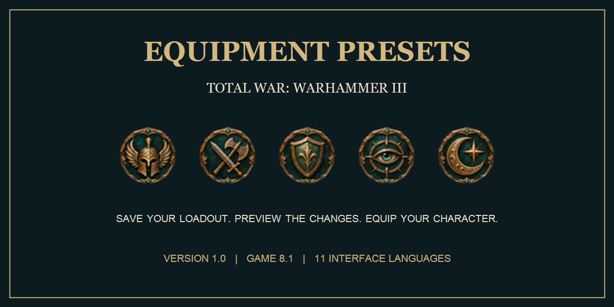

# Equipment Presets 1.0

Save and reuse equipment/follower loadouts for your lords and heroes, with a searchable persistent faction library, class-specific/shared presets, ten archetype icons, favorites, and a preview before application.

This release includes the approved bronze-and-teal favorite buttons: a hollow star for ordinary presets and a filled golden star for favorites.

## Steam Workshop

[Subscribe on Steam Workshop](https://steamcommunity.com/sharedfiles/filedetails/?id=3835603760). Enable only one copy: disable the manually installed GitHub pack if using Workshop.

## Download and install

Download `wh3_equipment_presets_probe.pack`, close the game, copy the pack to the game's `data` folder and enable it in your launcher. Keep only one copy enabled. `SHA256SUMS.txt` verifies the download. The historical filename is intentional; no separate test helper is included.

## Game compatibility

Target: **Total War: WARHAMMER III 8.1 / 8.1.0.0**.
Likely to work on **9+**, but **untested** on those versions.
Final native visual acceptance of the latest 1.0 artwork remains pending.

## Interface languages

English, Russian, Simplified Chinese, Traditional Chinese, Spanish, Brazilian Portuguese, German, Japanese, French, Polish and Korean. The active game language is detected automatically, with English fallback.

## Included assets

- `wh3_equipment_presets_probe.pack`
- `SHA256SUMS.txt`

## UI examples

[View the main interface screens](https://github.com/esnqduke/WH3-Equipment-Presets#ui-examples). These are offline renders from the 1.0 resources, with demonstration data and approximate font rendering.

## Development credits

Approximately 30 hours of development and iteration. Backend and mod logic: **GPT-6.1 Sol**. UI and visual design: **GPT-6 Astra**. Direction, requirements and in-game feedback: **esnqduke**.
